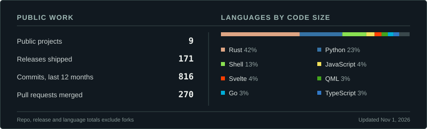

  

### Hi 👋

I build Linux tools for setup, updates, backups and recovery, with changes planned, shown and verified. I also make terminal apps for the things I follow every day.

- 🏈 Building **[Touchdown](https://github.com/Commanderx-code/touchdown-cli)**, a Go terminal dashboard for live NFL scores, game stats, standings and your favorite team
- 🧰 Working on **[Helix Toolbox](https://github.com/Commanderx-code/Helix-toolbox)**, a terminal menu and desktop window for Arch, Debian, Ubuntu, Fedora and openSUSE
- 🐟 Keeping **[Myfish](https://github.com/Commanderx-code/Myfish)**, my shell setup for Fish, Bash and Zsh, on Linux and macOS
- 💾 Building **[Helix Boot](https://github.com/Commanderx-code/helix-boot)**, a multiboot rescue USB that builds itself from upstream

  

### 🚀 Featured projects

<table>
  <tr>
    <td colspan="2" valign="top">
      <h4><a href="https://github.com/Commanderx-code/touchdown-cli">Touchdown</a></h4>
      Live NFL scores and stats in your terminal: weekly games, a favorite-team dashboard, standings, season schedules and a game center.  
      
      
      
    </td>
  </tr>
  <tr>
    <td width="50%" valign="top">
      <h4><a href="https://github.com/Commanderx-code/Helix-toolbox">Helix Toolbox</a></h4>
      Set up and look after a Linux machine from a terminal menu or a desktop window: installs, dotfiles, updates, backups and health checks.  
      
      
      
    </td>
    <td width="50%" valign="top">
      <h4><a href="https://github.com/Commanderx-code/Myfish">Myfish</a></h4>
      A customizable terminal setup for Linux and macOS: Fish, Bash or Zsh, with Starship, Nerd Fonts and optional Home Manager.  
      
      
      
    </td>
  </tr>
  <tr>
    <td width="50%" valign="top">
      <h4><a href="https://github.com/Commanderx-code/helix-boot">Helix Boot</a></h4>
      A multiboot rescue USB built from upstream: verified downloads, a Ventoy menu, a Windows PE desktop and offline packs.  
      
      
    </td>
    <td width="50%" valign="top">
      <h4><a href="https://github.com/Commanderx-code/dotfiles">dotfiles</a></h4>
      My Garuda Linux and KDE Plasma workstation, managed with Nix Home Manager: Fish, Starship and Neovim from one source, with Restic backups.  
      
      
      
    </td>
  </tr>
</table>

### 🛠️ Tools I work with

  
  
  
  
  
  
  
  
  
   
  
  
  
  
  

### 📊 Stats

### 🌱 Recently updated

<!-- UPDATED:START -->
- [**webos-launcher**](https://github.com/Commanderx-code/webos-launcher): A minimal home screen for LG webOS TVs: favorites, Plex rows, inputs, moving themes and a screensaver. Plain HTML, CSS and JavaScript for webOS 5 and later.
- [**touchdown-cli**](https://github.com/Commanderx-code/touchdown-cli)
- [**Helix-toolbox**](https://github.com/Commanderx-code/Helix-toolbox): Set up and look after a Linux machine from a terminal menu: installs, dotfiles, updates, backups and health checks, every change planned, confirmed and verified. Arch, Debian, Ubuntu, Fedora, openSUSE.
- [**helix-docs**](https://github.com/Commanderx-code/helix-docs): Documentation for the Helix tools: docs.helixtech.app
- [**helix-site**](https://github.com/Commanderx-code/helix-site): The Helix website: helixtech.app
<!-- UPDATED:END -->

### 🔨 Recent pull requests

<!-- PULLS:START -->
- [Move GitHub Actions to their Node 24 releases](https://github.com/Commanderx-code/touchdown-cli/pull/6) in [Commanderx-code/touchdown-cli](https://github.com/Commanderx-code/touchdown-cli) · open
- [Move GitHub Actions to their Node 24 releases](https://github.com/Commanderx-code/Helix-toolbox/pull/159) in [Commanderx-code/Helix-toolbox](https://github.com/Commanderx-code/Helix-toolbox) · open
- [Move GitHub Actions to their Node 24 releases](https://github.com/Commanderx-code/Commanderx-code/pull/1) in [Commanderx-code/Commanderx-code](https://github.com/Commanderx-code/Commanderx-code) · merged
- [Emulate a Cortex-A72 in the ARM64 virtual machines](https://github.com/Commanderx-code/Helix-toolbox/pull/158) in [Commanderx-code/Helix-toolbox](https://github.com/Commanderx-code/Helix-toolbox) · open
- [Put the new logo on the splash](https://github.com/Commanderx-code/helix-boot/pull/9) in [Commanderx-code/helix-boot](https://github.com/Commanderx-code/helix-boot) · merged
- [List Ventoy 1.1.18's checksum for the Linux window](https://github.com/Commanderx-code/helix-boot/pull/8) in [Commanderx-code/helix-boot](https://github.com/Commanderx-code/helix-boot) · merged
<!-- PULLS:END -->

### ⭐ Recent stars

<!-- STARS:START -->
- [brave/adblock-rust](https://github.com/brave/adblock-rust): Brave's Rust-based adblock engine
- [benjitaylor/skills](https://github.com/benjitaylor/skills): Skills for AI coding agents.
- [traefik/traefik](https://github.com/traefik/traefik): The Cloud Native Application Proxy
- [milind-soni/OpenMausBot](https://github.com/milind-soni/OpenMausBot): Open-source Grok Bot alternative with a virtual machine that bots can use
- [obra/superpowers](https://github.com/obra/superpowers): An agentic skills framework & software development methodology that works.
<!-- STARS:END -->

The lists and stats above refresh every day.
