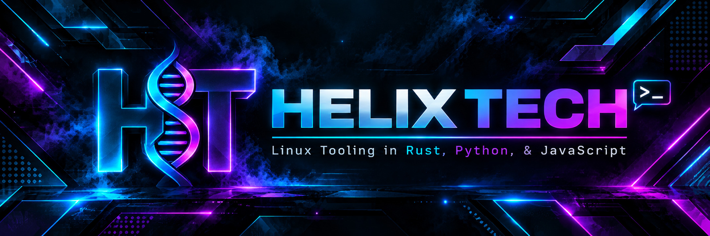
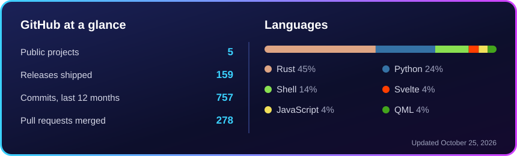

  

### Hi, I'm Matt 👋

I build Linux tools for setup, updates, backups and recovery, with changes planned, shown and verified. I also make terminal apps for the things I follow every day.

- 🏈 Building **[Touchdown](https://github.com/Commanderx-code/touchdown-cli)**, a Go terminal dashboard for live NFL scores, game stats, standings and your favorite team
- 🧰 Working on **[Helix Toolbox](https://github.com/Commanderx-code/Helix-toolbox)**, a terminal menu and desktop window for Arch, Debian, Ubuntu, Fedora and openSUSE
- 🐟 Keeping **[Myfish](https://github.com/Commanderx-code/Myfish)**, my shell setup for Fish, Bash and Zsh, on Linux and macOS
- 💾 Building **[Helix Boot](https://github.com/Commanderx-code/helix-boot)**, a multiboot rescue USB that builds itself from upstream

  

### 🚀 Featured projects

<table>
  <tr>
    <td colspan="2" valign="top">
      <h4><a href="https://github.com/Commanderx-code/touchdown-cli">Touchdown</a></h4>
      Live NFL scores and stats in your terminal: weekly games, a favorite-team dashboard, standings, season schedules and a game center.  
      
      
      
    </td>
  </tr>
  <tr>
    <td width="50%" valign="top">
      <h4><a href="https://github.com/Commanderx-code/Helix-toolbox">Helix Toolbox</a></h4>
      Set up and look after a Linux machine from a terminal menu or a desktop window: installs, dotfiles, updates, backups and health checks.  
      
      
      
    </td>
    <td width="50%" valign="top">
      <h4><a href="https://github.com/Commanderx-code/Myfish">Myfish</a></h4>
      A customizable terminal setup for Linux and macOS: Fish, Bash or Zsh, with Starship, Nerd Fonts and optional Home Manager.  
      
      
      
    </td>
  </tr>
  <tr>
    <td width="50%" valign="top">
      <h4><a href="https://github.com/Commanderx-code/helix-boot">Helix Boot</a></h4>
      A multiboot rescue USB built from upstream: verified downloads, a Ventoy menu, a Windows PE desktop and offline packs.  
      
      
    </td>
    <td width="50%" valign="top">
      <h4><a href="https://github.com/Commanderx-code/dotfiles">dotfiles</a></h4>
      My Garuda Linux and KDE Plasma workstation, managed with Nix Home Manager: Fish, Starship and Neovim from one source, with Restic backups.  
      
      
      
    </td>
  </tr>
</table>

### 🛠️ Tools I work with

  
  
  
  
  
  
  
  
  
   
  
  
  
  
  

### 📊 Stats

### 🌱 Recently updated

<!-- UPDATED:START -->
- [**webos-launcher**](https://github.com/Commanderx-code/webos-launcher): A minimal home screen for LG webOS TVs: favorites, Plex rows, inputs, moving themes and a screensaver. Plain HTML, CSS and JavaScript for webOS 5 and later.
- [**Helix-toolbox**](https://github.com/Commanderx-code/Helix-toolbox): Set up and look after a Linux machine from a terminal menu: installs, dotfiles, updates, backups and health checks, every change planned, confirmed and verified. Arch, Debian, Ubuntu, Fedora, openSUSE.
- [**Myfish**](https://github.com/Commanderx-code/Myfish): A customizable terminal setup for Linux and macOS. Fish, Bash or Zsh, with Starship, Nerd Fonts and optional Home Manager.
- [**helix-boot**](https://github.com/Commanderx-code/helix-boot): Helix Boot: a multiboot rescue USB that builds itself from upstream. Verified downloads, a Ventoy menu, the Lazarus PE Windows desktop, PortableApps.com with custom themes, and offline packs.
- [**dotfiles**](https://github.com/Commanderx-code/dotfiles): My Garuda Linux and KDE Plasma workstation, managed with Nix Home Manager: Fish, Starship, Fastfetch and Neovim from one source, one theme everywhere, and Restic backups.
<!-- UPDATED:END -->

### 🔨 Recent pull requests

<!-- PULLS:START -->
- [Publish the crates in a job of their own](https://github.com/Commanderx-code/Helix-toolbox/pull/148) in [Commanderx-code/Helix-toolbox](https://github.com/Commanderx-code/Helix-toolbox) · merged
- [Uninstall beside another Home Manager setup, and other review follow-ups](https://github.com/Commanderx-code/Myfish/pull/30) in [Commanderx-code/Myfish](https://github.com/Commanderx-code/Myfish) · merged
- [Fix bugs found in a repo-wide review](https://github.com/Commanderx-code/Myfish/pull/29) in [Commanderx-code/Myfish](https://github.com/Commanderx-code/Myfish) · merged
- [Helix Toolbox 1.25.0](https://github.com/Commanderx-code/Helix-toolbox/pull/147) in [Commanderx-code/Helix-toolbox](https://github.com/Commanderx-code/Helix-toolbox) · merged
- [Test the window's TypeScript with Vitest](https://github.com/Commanderx-code/Helix-toolbox/pull/146) in [Commanderx-code/Helix-toolbox](https://github.com/Commanderx-code/Helix-toolbox) · merged
- [Give every recovery restore command a fresh backup suffix](https://github.com/Commanderx-code/Myfish/pull/28) in [Commanderx-code/Myfish](https://github.com/Commanderx-code/Myfish) · merged
<!-- PULLS:END -->

### ⭐ Recent stars

<!-- STARS:START -->
- [throwaway96/slopbro](https://github.com/throwaway96/slopbro): PoC for jsserver vulnerability in webOS 3.5+(?)
- [spocky/miproja1](https://github.com/spocky/miproja1)
- [meddouribadis/arclauncher](https://github.com/meddouribadis/arclauncher): A minimal, open-source Android TV launcher featuring WiFi data usage widget, an inbuilt OLED friendly screensaver, and improved UX. A customized fork of FLauncher.
- [lenucksi/aur-malware-check](https://github.com/lenucksi/aur-malware-check): Detection tools for the June 2026 atomic-lockfile AUR supply-chain attack. Consolidated from community Gists.
- [anderson-arlen/PacSmith](https://github.com/anderson-arlen/PacSmith): Install and manage .deb, .rpm, and other Linux packages as native Arch Linux packages without the AUR
<!-- STARS:END -->

The lists and stats above refresh every day.
